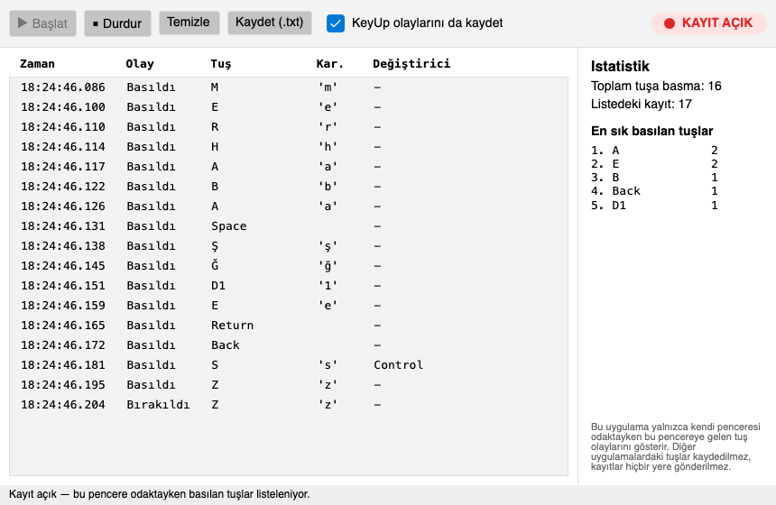
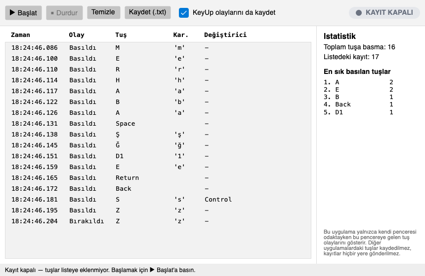
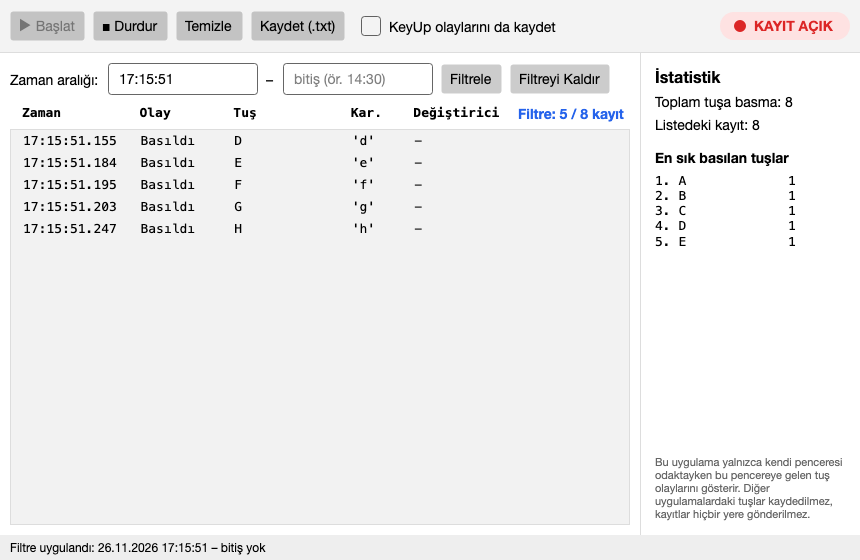

# YMH219 - Key Event Logger (Eğitsel)

Nesne Tabanlı Programlama (YMH 219) dersi ek uygulama ödevi. Klavye olaylarının (KeyDown / KeyUp) bir masaüstü uygulamasında nasıl yakalandığını ve işlendiğini gösteren eğitsel bir uygulama. Uygulama penceresi odaktayken basılan tuşları zaman bilgisiyle listeler, istatistik çıkarır ve kullanıcı isterse kayıtları `.txt` dosyasına kaydeder.

> **Kapsam ve güvenlik sınırı:** Bu uygulama gerçek bir sistem keylogger'ı **değildir**. Yalnızca kendi penceresi odaktayken bu pencereye gelen olayları gösterir. Global klavye hook'u, gizli/arka plan çalışması, başlangıçta otomatik çalışma, başka uygulamalardan veri toplama veya kayıtları ağ üzerinden gönderme **yoktur**. Kayıtlar yalnızca kullanıcı "Kaydet" dediğinde, kullanıcının seçtiği yerel dosyaya yazılır.

## Kullanılan Teknolojiler

- C# / .NET 8
- [Avalonia UI](https://avaloniaui.net/) 11.2 — çapraz platform masaüstü arayüz kütüphanesi
- NuGet paketleri: `Avalonia`, `Avalonia.Desktop`, `Avalonia.Themes.Fluent`
- Dosya işlemleri: `StreamWriter` (UTF-8)

> Ders föyünde ortam olarak Windows Forms belirtilmiştir; dersin hocasından WinForms'un zorunlu olmadığı onayı alınarak macOS'ta da çalışabilmesi için Avalonia tercih edilmiştir.

## Kurulum ve Çalıştırma

**Gereksinimler:** [.NET 8 SDK](https://dotnet.microsoft.com/download) (Windows, macOS veya Linux). NuGet paketleri ilk derlemede otomatik indirilir.

```bash
git clone https://github.com/insaninsan/YMH219-KeyEventLogger.git
cd YMH219-KeyEventLogger
dotnet run --project KeyEventLogger
```

Visual Studio 2022 / JetBrains Rider ile: `KeyEventLogger.sln` dosyasını açıp çalıştırın.

## Kullanım

1. **▶ Başlat** ile kaydı açın. Sağ üstteki gösterge kırmızı **KAYIT AÇIK** olur, pencere başlığında da `● KAYITTA` yazar.
2. Pencere odaktayken tuşlara basın. Her olay zaman, olay türü, tuş adı, üretilen karakter ve değiştirici tuşlarla (Shift, Control, Alt, Meta) listelenir.
3. İsterseniz **KeyUp olaylarını da kaydet** seçeneğiyle tuş bırakma olaylarını da listeye ekleyin.
4. **■ Durdur** ile kaydı kapatın, **Temizle** ile listeyi ve istatistikleri sıfırlayın.
5. **Zaman aralığı** kutularına başlangıç ve/veya bitiş yazıp **Filtrele**'ye basarak yalnızca o aralıktaki kayıtları görün. Saat (`14:05`, `14:05:30`) veya tarih ve saat (`25.11.2026 14:05`) yazılabilir; yalnızca saat yazılırsa bugünün tarihi kullanılır. **Filtreyi Kaldır** ile tüm kayıtlara dönün.
6. **Kaydet (.txt)** ile kayıtları seçtiğiniz bir metin dosyasına yazın. Filtre etkinse yalnızca filtrelenmiş kayıtlar kaydedilir.

## Özellikler

- KeyDown ve (isteğe bağlı) KeyUp olaylarının milisaniye hassasiyetinde zaman bilgisiyle listelenmesi
- Türkçe karakter desteği (ç, ğ, ı, ö, ş, ü)
- Başlat / Durdur / Temizle / Kaydet işlevleri; kayıt açıkken Başlat, kapalıyken Durdur butonu pasif
- Açık kayıt durumu göstergesi (renkli rozet + pencere başlığı)
- İstatistik: toplam tuşa basma sayısı ve en sık basılan 5 tuş
- Kayıtları tarih/saat aralığına göre filtreleme (yeni kayıtlar aralığa giriyorsa listeye canlı eklenir)
- Pencere arka plana geçince durum çubuğunda "diğer uygulamalardaki tuşlar kaydedilmez" uyarısı
- Hata yönetimi: boş listeyi kaydetmeye çalışma, iptal edilen kaydetme ve dosya yazma hataları durum çubuğunda kullanıcıya bildirilir; uygulama kapanmaz

### Kayıt dosyası biçimi

Sekmeyle ayrılmış, UTF-8 metin:

```
# YMH219 Key Event Logger kayıtları
# Oluşturulma: 2026-11-25 18:24:46
# Zaman	Olay	Tuş	Karakter	Değiştirici
2026-11-25 18:24:46.086	KeyDown	M	m	-
2026-11-25 18:24:46.138	KeyDown	Ş	ş	-
2026-11-25 18:24:46.181	KeyDown	S	s	Control
```

## Proje Yapısı

```
KeyEventLogger/
├── Program.cs              Uygulamanın giriş noktası
├── App.axaml(.cs)          Uygulama ve tema tanımı
├── MainWindow.axaml        Pencere düzeni: araç çubuğu, kayıt listesi, istatistik paneli, durum çubuğu
├── MainWindow.axaml.cs     Klavye olaylarını yakalama, buton işlevleri, gösterge ve dosyaya kaydetme
└── Models/
    ├── KeyEventRecord.cs   Tek bir klavye olayının değişmez kaydı (zaman, tür, tuş, karakter, değiştirici)
    ├── KeyLogger.cs        Kayıt durumu, kayıt listesi ve istatistikler; RecordingStateChanged / StatisticsChanged olayları
    ├── TimeRangeParser.cs  Filtre kutularındaki tarih/saat metnini çözer
    └── LogFileWriter.cs    Kayıtları StreamWriter ile .txt dosyasına yazar
```

`KeyLogger` arayüzden bağımsızdır: pencere yakaladığı her olayı `Record()` ile ona verir; kayıt kapalıysa olay listeye eklenmez. Arayüz, `KeyLogger`'ın olaylarını dinleyerek butonları, göstergeyi ve istatistikleri günceller.

Klavye olayları pencereye **tunnel** yönlendirme ile bağlanır (`AddHandler(KeyDownEvent, ..., RoutingStrategies.Tunnel)`): olay, odaktaki kontrole ulaşmadan önce pencereye gelir, böylece hangi kontrol odakta olursa olsun yakalanır. Bu, Windows Forms'taki `KeyPreview = true` davranışının karşılığıdır.

## Ekran Görüntüleri

| Kayıt açık | Kayıt durduruldu |
|---|---|
|  |  |

**Zaman aralığı filtresi** (yalnızca 17:15:51'den sonraki kayıtlar):



## Bilinen Sınırlamalar / Geliştirme Notları

- İşletim sistemine ait kısayollar (ör. macOS'ta `Cmd+Tab`, Windows'ta `Alt+Tab`) uygulamaya hiç ulaşmadığı için listelenmez.
- Bazı tuşların adı platforma göre farklı görünebilir (ör. `Enter` tuşu `Return`, `Backspace` tuşu `Back` olarak listelenir).
- Tuş basılı tutulduğunda işletim sisteminin gönderdiği tekrar olayları da ayrı ayrı kaydedilir.
- Kayıtlar yalnızca bellekte tutulur; kaydedilmeden uygulama kapatılırsa kaybolur.

## Öğrenci

- **Ad Soyad:** Şerif Bayram
- **Öğrenci No:** 225541018
